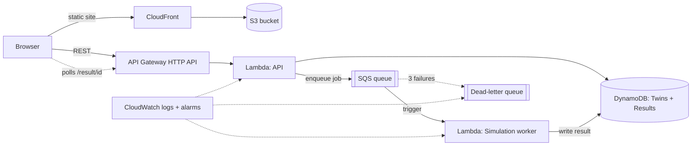

# FinVerse - Financial Digital Twin & Scenario Simulation Platform

[🌐 Live Demo - FinVerse | Your Financial Digital Twin](https://d36le3iyrjyt87.cloudfront.net/?#sim)

VCC (Cloud Computing) course project. FinVerse turns a user's financial profile into a **digital twin**, then
simulates thousands of possible futures (Monte Carlo) and stress-tests them with **crash scenarios** - all on a
serverless AWS architecture.

## Architecture



**Why it is cloud-native:** `POST /simulate` returns immediately (HTTP 202 + `job_id`). The heavy Monte Carlo run is
decoupled through **SQS** and executed by a separate **Lambda worker**, which writes the result to **DynamoDB**.
The browser polls for completion, so a long simulation never blocks the API.

## Features

| Feature | Where |
|---|---|
| Financial Twin (income, expenses, SIP, savings, loans with auto-calculated EMI, goals; expenses + SIP + EMIs must fit within income) | `backend/engine.py` `clean_twin`, `POST /twin` |
| Monte Carlo future simulator (best / median / worst, VaR, goal probability, ruin risk) | `backend/engine.py` `simulate` |
| Async pipeline (SQS + Lambda worker + dead-letter queue) | `backend/app.py`, `backend/worker.py`, `template.yaml` |
| Crash Test (market crash, job loss, inflation spike, perfect storm) | `SCENARIOS` in `engine.py` - same engine, shock parameters |
| Financial DNA (rule-based archetype + health score) | `engine.py` `financial_dna` |
| Dashboard (fan chart, distribution, goal bars, live job tracker, history) | `frontend/index.html` |
| Investment plan tab (year-by-year invested vs portfolio value to retirement, optional SIP step-up; realistic-median or expected growth) | `frontend/index.html` (runs in the browser, no API call) |
| Retirement SWP tab (how many years a corpus lasts for a given monthly withdrawal, with inflation) | `frontend/index.html` (runs in the browser, no API call) |
| Monitoring (7-day log retention, DLQ + worker-error alarms) | `template.yaml` |

AWS services: API Gateway, Lambda, SQS, DynamoDB, S3, CloudFront, CloudWatch, IAM (via SAM/CloudFormation).

## API

| Method | Path | Description |
|---|---|---|
| POST | `/twin` | Save/update a twin, returns twin + DNA |
| GET | `/twin/{user_id}` | Load twin |
| POST | `/simulate` | `{user_id, scenario, years, num_paths}` → `202 {job_id}` (queued) |
| GET | `/result/{job_id}` | `QUEUED` / `RUNNING` / `DONE` (+ result) / `FAILED` |
| GET | `/history/{user_id}` | Recent runs |

## Run locally (no AWS, no installs)

```bash
python3 local_server.py      # then open http://localhost:8000
python3 -m unittest discover -s tests -v
```

Locally the queue is replaced by a background thread and DynamoDB by an in-memory store; the same code runs in both.

## Deploy to AWS

Needs the AWS CLI + SAM CLI (both preinstalled/installable in AWS CloudShell).

```bash
bash deploy.sh
```

This runs `sam build`, `sam deploy` (DynamoDB, SQS, Lambdas, API Gateway, S3, CloudFront, alarms), then uploads the
frontend with the live API URL. The script prints the website URL at the end. First deploy takes ~5–10 minutes
(CloudFront). To remove everything: empty the S3 bucket, then `aws cloudformation delete-stack --stack-name finverse`.

Free-tier friendly: pay-per-request DynamoDB, 256–512 MB Lambdas, API throttling, no always-on resources.

Step-by-step guide (CloudShell deploy, GitHub push, optional GitHub Actions deploy): see [DEPLOY.md](DEPLOY.md).

## Limitations / future work

- No user authentication yet - users are identified by a self-chosen ID. Next step: Amazon Cognito + API Gateway JWT authorizer.
- Simulation assumes normally distributed monthly returns and a simplified cash-flow model (not financial advice).
- Decision Lab / "find my breaking point" can reuse the same engine (run twice and diff).
